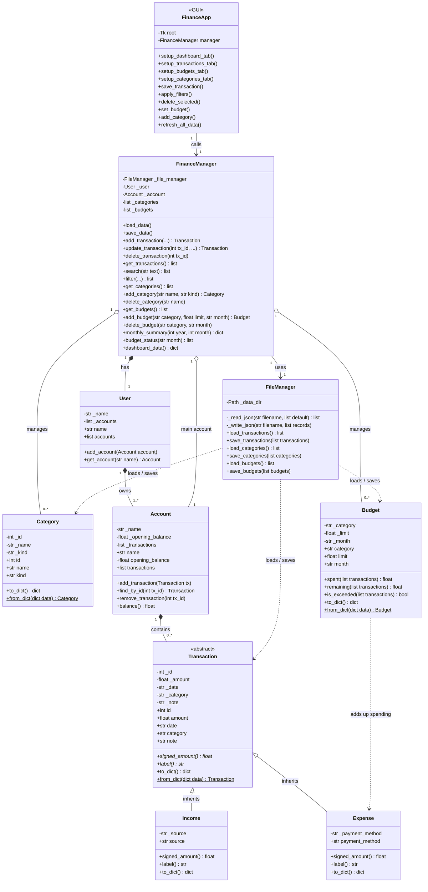
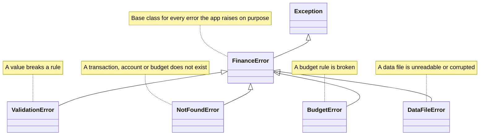
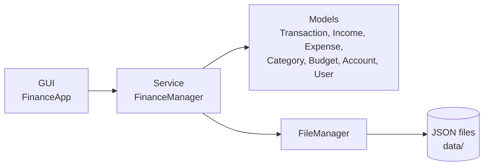

# UML class diagrams

These diagrams use [Mermaid](https://mermaid.js.org/), which GitHub renders automatically when you open this file. To get a picture for a report or slides, paste a diagram into <https://mermaid.live> and export it as PNG or SVG.

## 1. Main class diagram

## 2. Exception hierarchy

## 3. Layers

## Legend

| Symbol | Meaning |
|---|---|
| `<\|--` | inheritance (`Income` is a `Transaction`) |
| `*--` | composition (the part cannot live without the whole) |
| `o--` | aggregation (the manager holds the object) |
| `-->` | association (uses) |
| `..>` | dependency |
| `-` / `+` | private / public member |
| `*` after a method | abstract method |
| `$` after a method | static method |
